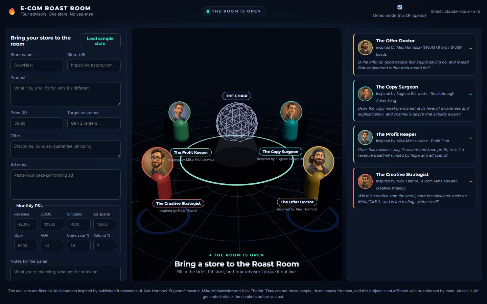

# 🔥 E-com Roast Room

A local web app where four AI advisor characters roast and coach your e-commerce store, live, around a 3D table.



You paste in your store URL, product, offer, ad copy and a simple monthly P&L. Then:

1. **Round 1, the roast.** Each advisor streams a roast, three specific fixes and a 0–10 score through their own lens.
2. **Round 2, cross-fire.** Each advisor reads the others and ENDORSES, AMENDS or OBJECTS to one point.
3. **The Chair's verdict.** A neutral chair merges everything into a 0–100 score, a confidence level, an ordered action plan and "watch out" quotes.

Everything streams into the three.js room (speech bubbles, spotlights, score rings, the Chair hologram) and the side panels at the same time.

| Seat | Character | Inspired by | Lens |
|---|---|---|---|
| 🟡 | The Offer Doctor | Alex Hormozi ($100M Offers / Leads) | Offer strength, value stacking, unit economics |
| 🟢 | The Copy Surgeon | Eugene Schwartz (Breakthrough Advertising) | Awareness level, market sophistication, headlines |
| 🟩 | The Profit Keeper | Mike Michalowicz (Profit First) | Owner pay, profit allocation, cash discipline |
| 🔴 | The Creative Strategist | Nick Theriot (e-com ads and creative) | Hooks, angles, formats, testing cadence |

> **Disclaimer:** The advisors are fictional AI characters *inspired by* published frameworks. They are not Alex Hormozi, Eugene Schwartz, Mike Michalowicz or Nick Theriot, they don't speak for them, and this project isn't affiliated with or endorsed by any of them. The system prompts tell every character never to claim to be the real person or invent quotes from them. The clay-style portraits in `public/avatars/` are stylised caricatures that help tell the characters apart; they are not photos of the real people. Advice is AI-generated, so check the numbers before you act on it.

## Quick start

Requirements: Node.js 20+ (no admin rights or global installs needed; everything installs into this folder).

```bash
git clone https://github.com/alfredyeo93-ux/ecom-roast-room.git
cd ecom-roast-room
npm install && npm run dev
```

Then open http://localhost:5178. Tick **Demo mode** to replay a pre-written roast of the sample store with zero API spend.

### Live mode: add your Claude API key

**Easiest: paste it into the app.** Open **Your Claude API key** above the Start button and paste a key from [console.anthropic.com](https://console.anthropic.com/settings/keys). It works like this:

- The key stays in your browser (`sessionStorage`, or `localStorage` only if you tick **Remember on this device**). **Clear** removes it.
- It's sent to the Roast Room server in an `x-anthropic-key` header with each live roast, used for that one request, and never logged or written to `runs/`.
- Whoever runs the server could read it. Only paste your key into a Roast Room you run yourself or trust. If you host this for other people, use HTTPS.

**Or set it on the server.** The server reads `ANTHROPIC_API_KEY` from the environment and never prints or stores it. A key pasted in the browser takes priority over the server's key.

On Windows, set it once for your user (no admin needed):

```bash
setx ANTHROPIC_API_KEY "sk-ant-..."
```

`setx` only affects terminals opened afterwards. The server also reads the value straight from your Windows user environment (`HKCU\Environment`), so it works even from a terminal that was already open. On macOS or Linux, `export ANTHROPIC_API_KEY=...` before `npm run dev`.

`GET /api/health` reports whether a key was found (`hasKey`) and where it came from, never the key itself.

### Open it in Claude Code's preview

`.claude/launch.json` defines a `roast-room` server on port 5178, so Claude Code's browser preview can start it by name.

## Cost

Each live roast makes 9 Claude calls: 4 roasts, 4 cross-fire replies and 1 verdict. With the default `claude-opus-5-5` ($4 / $20 per million input/output tokens), expect about **$0.30–$0.80 per roast**, depending on how much the model thinks. The header shows the token count and estimated cost after every run.

## Configuration (environment variables)

| Variable | Default | What it does |
|---|---|---|
| `ANTHROPIC_API_KEY` | none | Your Claude API key |
| `ROAST_MODEL` | `claude-opus-5-5` | Any Claude model id, e.g. `claude-sonnet-5-5` for cheaper runs |
| `ROAST_EFFORT_R1` / `_R2` / `_CHAIR` | `medium` / `low` / `medium` | Thinking effort per round (`low`…`max`) |
| `ROAST_FALLBACKS` | `on` | Server-side refusal fallback (`fallbacks: "default"`); set `off` to disable |
| `ROAST_BASE_URL` | `https://api.anthropic.com` | API endpoint. `ANTHROPIC_BASE_URL` is deliberately ignored, because Claude Code sets it for its own traffic |
| `PORT` | `5178` | HTTP port |

## How it works

```
public/            static frontend, no build step
  index.html       layout: brief form | 3D room | advisor panels
  scene.js         three.js room (table, seats, bots, hologram Chair, CSS2D labels and bubbles)
  app.js           form, streaming reader (fetch + SSE), panels, verdict
  sample-store.json  the GlowNest sample store
server/
  index.js         Express: static files, /api/health, POST /api/roast (Server-Sent Events)
  roast.js         the 3-stage orchestration with the Anthropic SDK (streaming)
  personas.js      characters, prompts, output formats, verdict JSON schema
  knowledge/*.md   per-advisor framework notes (written in our own words) and the banned-copy-patterns list
  brief.js         input cleaning, computed unit economics, optional homepage fetch
  parse.js         tolerant parsers, shared with the browser
  demo.js          demo-mode replay of data/demo-roast.json
  apiKey.js        env / Windows user-env key lookup
  ads.js           Meta ad data, CSV import, funnel staging, survey and competitor ranking (shared with the browser)
.claude/commands/
  roast-research.md  Claude Code command that pulls your ads and your niche's competitor ads via the Meta Ads connector
```

## Ads, survey and competitor research (optional)

Give the panel your real ad numbers and customer words, and the verdict (and PDF report) adds three sections:

- **Your ads by funnel stage:** spend, ROAS, CPA and CTR for top (cold prospecting), middle (engagers, video viewers) and bottom of funnel (retargeting), plus a verdict per stage: double down, fix, cut, or build what's missing.
- **Voice of customer → creative:** the top reasons people bought, quoted from your post-purchase survey, turned into hooks and angles for new ads.
- **What to test next:** tests based on your niche's competitor ads.

Three ways to load the data, from the **Ads & customer research** box in the form:

1. **Claude Code + Meta Ads connector (recommended).** Paste your Ads Manager link and your niche into the box, copy the generated command, and run it in Claude Code from this folder, for example `/roast-research https://adsmanager.facebook.com/...act=123 | sunset lamp projector`. It reads your last 30 days of ads (read-only) and searches the Meta Ad Library, then writes `research/<account>-<date>.json`. Click **Use latest research**.
2. **Ads Manager CSV.** In Ads Manager, export an ad-level report (Ad name, Campaign name, Ad set name, Amount spent, Impressions, CTR, Link clicks, Adds to cart, Purchases, Purchases conversion value, ThruPlays) and upload it.
3. **Post-purchase survey.** Paste answers (one per line) or upload a CSV from Fairing, KnoCommerce or a Shopify form.

Notes:

- Funnel stages are inferred from campaign and ad set names (prospecting/broad/LAL, engagers/video viewers, retargeting/visitors/ATC/DPA, Advantage+). Add a `stage` column (TOF/MOF/BOF/ALL) to override.
- **Meta doesn't publish spend for commercial ads**, so nobody can tell you a competitor's real spend. The Roast Room ranks competitor ads by a spend proxy: how long each ad has run, with every extra live variant counted like a week of runtime. The report says so.
- `research/*.json` is gitignored: it holds your private ad numbers. It's only sent to your own Roast Room server with a roast, and from there to Claude as part of the brief.
- **Load sample store** also loads a clearly labelled sample ad account, survey and competitor set, so demo mode shows every section.

- **Computed metrics:** before any model call, the server works out orders, gross and contribution margin, net profit, MER, break-even ROAS and CAC from your P&L. The advisors argue about strategy instead of doing arithmetic.
- **Homepage fetch:** if you give a store URL, the server grabs the page title, meta description and visible text (capped at 2,500 chars). Untick it in the form to skip.
- **Verdict:** uses structured outputs (`output_config.format` with a JSON schema), so the plan always parses.
- **PDF report:** **Download PDF report** on the verdict opens a printable A4 report (verdict, your numbers, advisor scores, the plan in order, each advisor's stance and top fix, watch-out quotes). Choose **Save as PDF** in the print dialog. It's built in the browser from the roast you just ran; nothing extra is sent anywhere.
- **Run transcripts:** every roast is saved to `runs/<timestamp>.json` (final advisor replies, verdict, token usage). `runs/` is gitignored because it holds your store's numbers.
- **Self-check:** `npm run check` tests the parsers, metrics and prompt assembly offline, with no API calls.

## Knowledge base and copyright

`server/knowledge/*.md` holds short framework summaries written in our own words from the owner's reference library. No book text or PDFs live in this repo. `.gitignore` blocks `*.pdf`, `*.epub`, `*.rtf`, `ebooks/` and `kb-local/`, so anything you keep locally for reference stays out of git. `banned-patterns.md` is the owner's own copywriting blacklist and applies to all advisor output.

## Credits

- Built with [three.js](https://threejs.org) (MIT) and the [Anthropic TypeScript SDK](https://github.com/anthropics/anthropic-sdk-typescript) (MIT), served with [Express](https://expressjs.com) (MIT).
- The staged council flow (independent opinions, then peer review, then a chair) is inspired by [karpathy/llm-council](https://github.com/karpathy/llm-council). That repo has no licence, so no code was copied; this is an original implementation.
- The "roast room" format (a chair convenes advisors, rounds of argument, a scored verdict with endorse/amend counts) was inspired by the ["Roast Room Council" reel](https://www.instagram.com/reel/De7MatdDOnZ/) by [@nateherkai](https://www.instagram.com/nateherkai/). No assets from the reel are used.

## Contributing

Issues and pull requests are welcome. Before opening a PR:

- Run `npm run check` (offline, no API calls).
- Run a **Demo mode** roast in the browser to make sure the room still plays end to end.
- Don't add book text, PDFs or anything you don't have the rights to. Knowledge notes must be in your own words.
- Never commit API keys or files from `runs/`.

Ideas that would help: more advisor personas, a Shopify/URL importer for the brief, exporting the verdict as a PDF, and support for other currencies.

## Licence

MIT. See [LICENSE](LICENSE).
